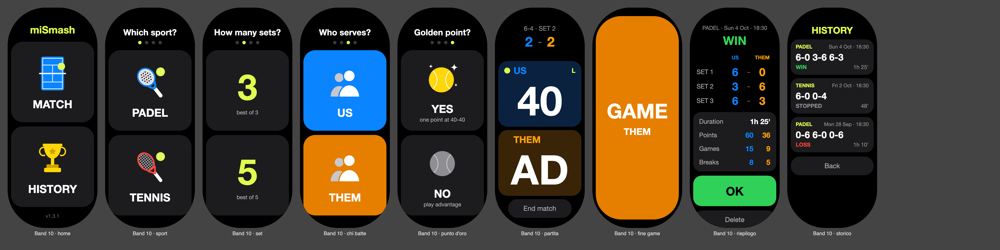
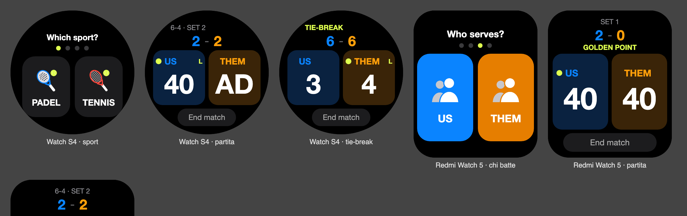

# miSmash · padel and tennis scorekeeper for Xiaomi Smart Band and Xiaomi watches

[Italiano](README.md) · **English** · [Español](README.es.md)

Vela JS app (quick app) to keep the score of padel or tennis matches from your wrist.

**[⬇ Download the latest version](../../releases/latest)** · **[How to install it](INSTALL.md)** · **[☕ Buy me a coffee](https://www.paypal.com/qrcodes/p2pqrc/QNC3L2PQG7LHG)**





The images are previews generated from the app's code: on the real device fonts and details may differ slightly.

## How to use it

1. **Home**: tap **MATCH** to start or **HISTORY** to see the matches you played.
2. Four choices, one per screen: **PADEL or TENNIS**, best of **3 or 5 sets**, **who serves** first (US / THEM), **golden point** yes or no (in tennis "deciding point"). After the last choice the match starts.
   To go back to the previous choice use the device's back gesture.
3. **Match**: tap the panel of the team that won the point. **Press and hold** a panel to undo that team's last point.
   - At the top you see the finished sets, the games of the current set and, when needed, TIE-BREAK or GOLDEN POINT.
   - The **yellow dot** shows who serves and **R / L** from which side. Service changes automatically every game; in the tie-break it follows the 1-2-2 rule. On the golden point no side is shown, because the receivers choose it.
   - On every point the number grows and the panel lights up; when you undo, the number shakes.
   - After every game, set or at the end of the match a coloured screen shows up for a moment. Tap it to close it right away.
4. **End match** closes the match, even before it is over (for example when your court time is up). It is saved in the history and the **summary** opens: sets, duration, points, games and breaks won by each team. **OK** takes you back home.
5. The **history** shows the last 30 matches. Tap one to see its summary; from there you can also delete it (double tap to confirm).

The installed version number is shown at the bottom of the home screen.

Rules: best of 3 or 5 sets, sets to 6 with a tie-break to 7 at 6-6, advantage or golden point. Padel and tennis are scored the same way.

The match is saved on every point: if you leave the app or the band closes it, open it again and carry on where you left off.
During the match the screen stays on; it turns off again as soon as you leave the app.

**Languages**: Italian, English and Spanish. The app uses the device language (which follows the phone's); with any other language it is in English.

## Devices

The app adapts to the shape of the screen:

| Shape | Models |
|---|---|
| Band (pill) | Xiaomi Smart Band 9, Smart Band 10 |
| Rectangular | Xiaomi Smart Band 8 Pro, Smart Band 9 Pro, REDMI Watch 5 |
| Round | Xiaomi Watch S1 Pro, H1, S3, S4, S4 Sport, S5 |

Tested on the Smart Band 10. On the other models the layout is adapted to the screen shape but not yet tested on a real device: if something looks cut off or out of place, please report it.
It does not work on Wear OS watches (e.g. Xiaomi Watch 2) or on watches of other brands.

## Download and install

On the **[Releases](../../releases/latest)** page there are two files, pick one:

- `com.padelscore.band.debug.<version>.rpk`: automatic language (the device's);
- `com.padelscore.band.debug.<version>-it.rpk`: always in Italian, whatever the device language.

The file name keeps the app's original identifier (`com.padelscore.band`): changing it would install miSmash as a new app next to the old one, which cannot be removed from the band.

The charging cable carries no data: the app is installed over Bluetooth with [AstroBox](https://astrobox.online), an unofficial tool.
All the steps, including what to do if AstroBox does not find the device from your Xiaomi account, are in **[INSTALL.md](INSTALL.md)**.

## Buy me a coffee ☕

The app is free. If you find it useful and want to say thanks, you can buy me a coffee with PayPal: **[pay with PayPal](https://www.paypal.com/qrcodes/p2pqrc/QNC3L2PQG7LHG)** or scan the QR code.


## Build

```bash
npm install
npm test          # tests of the scoring logic
npm run build     # → dist/com.padelscore.band.debug.<version>.rpk     (automatic language)
npm run build:it  # → dist/com.padelscore.band.debug.<version>-it.rpk  (always Italian)
npm run icon      # regenerates the app icon and the card images
```

To install with AstroBox always use the **debug** package (`npm run build`), not `npm run release`.
If `npm run build` reports "missing feature", add what it says to `features` in the manifest.
For every new version increase `versionCode` and `versionName` in `src/manifest.json`: with the same `versionCode` the band keeps the old version. `versionName` is the one shown at the bottom of the home screen.

### Publishing a new version

1. Increase `versionCode` and `versionName` in `src/manifest.json` (and `version` in `package.json`).
2. `npm test`, then `npm run build` and `npm run build:it`.
3. On GitHub create a **Release** with tag `v<version>` (e.g. `v1.3.1`), write what's new and attach the two `.rpk` files from `dist/`.
4. Add the version at the bottom of the READMEs, in the [Versions](#versions) section.

## Structure

```
src/
├── manifest.json          package, permissions (storage, vibration, brightness, screen and app info), designWidth 212
├── app.ux
├── common/
│   ├── score.js           pure scoring logic (games, sets, tie-break, service, stats, history)
│   ├── format.js          texts: dates, durations, set scores
│   ├── i18n.js            translations (Italian, English, Spanish) and language choice
│   ├── build.js           fixed language for dedicated packages (empty = automatic)
│   ├── icon.png           icon (generated by tools/gen-icon.mjs)
│   └── *.png              card images: court, trophy, rackets, players, balls (same)
└── pages/index/index.ux   single page: home, choices, match, confirmation, history, summary
tools/
├── test-logic.mjs         logic tests (npm test)
├── build-lang.mjs         package with a fixed language (npm run build:it)
└── gen-icon.mjs           generates icon and images (npm run icon)
```

The base styles are for the band; at the end of `index.ux` there are the `@media (shape: rect)` and `@media (shape: circle)` variants.
The screen height comes from `device.getInfo`, because in design px the width is always 212.

## Notes for developers

Things seen on the real Band 10 that the browser preview doesn't show:

- **Screen corners** are very rounded: count on a radius of about 90 px (on a 212 px width). That's why there are 40 px of margin at the top and 24 at the bottom, and the buttons near the edges are narrow and centred.
- **Coloured backgrounds**: on a full screen the background stayed black, both from a dynamic class and from an inline style. An inner card with the class written in the template and a fixed height works (see `flash-card`).
- **Animations** shorter than half a second can't be seen: keep them around 0.5-1 s and well marked.
- `@system.app` must be declared in the manifest `features`, even though the docs say it isn't needed: without it the build stops.
- **Translations** live in `src/common/i18n.js`: every language must have the same keys (`npm test` checks it). Keep texts short; for the narrow watch panels there are `usShort` and `themShort`.

## Versions

- **1.3.1**: new name, miSmash; choice between 3 and 5 sets; Italian, English and Spanish, plus an always-Italian package; the end-of-match titles (VICTORY, DEFEAT) now fit on screen.
- **1.2.0**: start flow with image screens (home, sport, who serves, golden point); removed the undo arrow (press and hold stays).
- **1.1.x**: tennis, End match, history and summary with stats, GAME / SET screens, serving side, animations, round and rectangular watches, margins for the band's corners, version shown on the home screen.
- **1.0.0**: first version, padel scorekeeper for the Smart Band 10.

## License

[MIT](LICENSE). Personal, unofficial project, not affiliated with Xiaomi or AstroBox.
