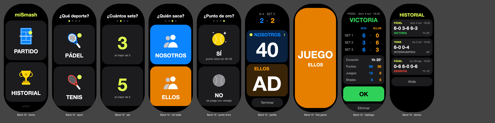
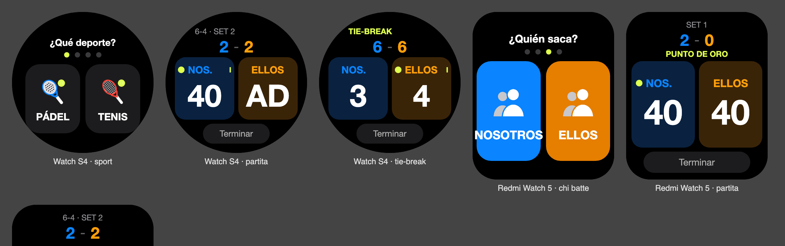

# miSmash · marcador de pádel y tenis para Xiaomi Smart Band y relojes Xiaomi

[Italiano](README.md) · [English](README.en.md) · **Español**

App Vela JS (quick app) para llevar el marcador de pádel o tenis desde la muñeca.

**[⬇ Descarga la última versión](../../releases/latest)** · **[Cómo instalarla](INSTALACION.md)** · **[☕ Invítame a un café](https://www.paypal.com/qrcodes/p2pqrc/QNC3L2PQG7LHG)**





Las imágenes son vistas previas generadas a partir del código de la app: en el dispositivo real las fuentes y los detalles pueden cambiar un poco.

## Cómo se usa

1. **Inicio**: toca **PARTIDO** para empezar o **HISTORIAL** para ver los partidos jugados.
2. Cuatro elecciones, una por pantalla: **PÁDEL o TENIS**, al mejor de **3 o 5 sets**, **quién saca** primero (NOSOTROS / ELLOS), **punto de oro** sí o no (en tenis "punto decisivo"). Tras la última elección empieza el partido.
   Para volver a la elección anterior usa el gesto de volver del dispositivo.
3. **Partido**: toca el panel del equipo que ha ganado el punto. **Mantén pulsado** un panel para deshacer el último punto de ese equipo.
   - Arriba ves los sets terminados, los juegos del set en curso y, cuando hace falta, TIE-BREAK o PUNTO DE ORO.
   - El **punto amarillo** indica quién saca y **D / I** desde qué lado. El saque cambia solo en cada juego; en el tie-break sigue la regla 1-2-2. En el punto de oro no aparece el lado, porque lo elige quien resta.
   - En cada punto el número se agranda y el panel se ilumina; al deshacer, el número tiembla.
   - Tras cada juego, set o al final del partido aparece un momento una pantalla de color. Tócala para cerrarla enseguida.
4. **Terminar** cierra el partido, incluso antes de que acabe (por ejemplo cuando se acaba la hora de pista). Se guarda en el historial y se abre el **resumen**: sets, duración, puntos, juegos y breaks ganados por cada equipo. **OK** vuelve al inicio.
5. El **historial** muestra los últimos 30 partidos. Toca uno para ver su resumen; desde ahí también puedes eliminarlo (con doble toque de confirmación).

Abajo en la pantalla de inicio aparece el número de versión instalada.

Reglas: al mejor de 3 o de 5 sets, sets a 6 con tie-break a 7 en el 6-6, ventaja o punto de oro. Pádel y tenis se cuentan igual.

El partido se guarda en cada punto: si sales de la app o la pulsera la cierra, vuelve a abrirla y sigue donde lo dejaste.
Durante el partido la pantalla se queda encendida; se vuelve a apagar en cuanto sales de la app.

**Idiomas**: italiano, inglés y español. La app usa el idioma del dispositivo (que sigue al del teléfono); con cualquier otro idioma está en inglés.

## Dispositivos

La app se adapta a la forma de la pantalla:

| Forma | Modelos |
|---|---|
| Pulsera (cápsula) | Xiaomi Smart Band 9, Smart Band 10 |
| Rectangular | Xiaomi Smart Band 8 Pro, Smart Band 9 Pro, REDMI Watch 5 |
| Redonda | Xiaomi Watch S1 Pro, H1, S3, S4, S4 Sport, S5 |

Probada en la Smart Band 10. En los demás modelos el diseño se adapta a la forma de la pantalla pero todavía no se ha probado en un dispositivo real: si algo sale cortado o descolocado, avísame.
No funciona en relojes Wear OS (p. ej. Xiaomi Watch 2) ni en relojes de otras marcas.

## Descargar e instalar

En la página **[Releases](../../releases/latest)** hay dos archivos, elige uno:

- `com.padelscore.band.debug.<versión>.rpk`: idioma automático (el del dispositivo);
- `com.padelscore.band.debug.<versión>-it.rpk`: siempre en italiano, sea cual sea el idioma del dispositivo.

El nombre del archivo mantiene el identificador original de la app (`com.padelscore.band`): cambiarlo instalaría miSmash como una app nueva junto a la antigua, que no se puede quitar de la pulsera.

El cable de carga no transmite datos: la app se instala por Bluetooth con [AstroBox](https://astrobox.online), una herramienta no oficial.
Todos los pasos, incluido qué hacer si AstroBox no encuentra el dispositivo desde la cuenta Xiaomi, están en **[INSTALACION.md](INSTALACION.md)**.

## Invítame a un café ☕

La app es gratuita. Si te resulta útil y quieres dar las gracias, puedes invitarme a un café con PayPal: **[pagar con PayPal](https://www.paypal.com/qrcodes/p2pqrc/QNC3L2PQG7LHG)** o escanea el código QR.


## Compilar

```bash
npm install
npm test          # pruebas de la lógica del marcador
npm run build     # → dist/com.padelscore.band.debug.<versión>.rpk     (idioma automático)
npm run build:it  # → dist/com.padelscore.band.debug.<versión>-it.rpk  (siempre en italiano)
npm run icon      # regenera el icono de la app y las imágenes de las tarjetas
```

Para instalar con AstroBox usa siempre el paquete **debug** (`npm run build`), no `npm run release`.
Si `npm run build` muestra "missing feature", añade en `features` del manifest lo que indique.
En cada versión nueva aumenta `versionCode` y `versionName` en `src/manifest.json`: con el mismo `versionCode` la pulsera mantiene la versión antigua. `versionName` es la que aparece abajo en la pantalla de inicio.

### Publicar una versión nueva

1. Aumenta `versionCode` y `versionName` en `src/manifest.json` (y `version` en `package.json`).
2. `npm test`, luego `npm run build` y `npm run build:it`.
3. En GitHub crea una **Release** con la etiqueta `v<versión>` (p. ej. `v1.3.1`), escribe las novedades y adjunta los dos archivos `.rpk` de `dist/`.
4. Añade la versión al final de los README, en la sección [Versiones](#versiones).

## Estructura

```
src/
├── manifest.json          paquete, permisos (almacenamiento, vibración, brillo, info de pantalla y app), designWidth 212
├── app.ux
├── common/
│   ├── score.js           lógica pura del marcador (juegos, sets, tie-break, saque, estadísticas, historial)
│   ├── format.js          textos: fechas, duraciones, resultados de los sets
│   ├── i18n.js            traducciones (italiano, inglés, español) y elección del idioma
│   ├── build.js           idioma fijo para los paquetes dedicados (vacío = automático)
│   ├── icon.png           icono (generado por tools/gen-icon.mjs)
│   └── *.png              imágenes de las tarjetas: pista, copa, raquetas, jugadores, pelotas (ídem)
└── pages/index/index.ux   única página: inicio, elecciones, partido, confirmación, historial, resumen
tools/
├── test-logic.mjs         pruebas de la lógica (npm test)
├── build-lang.mjs         paquete con idioma fijo (npm run build:it)
└── gen-icon.mjs           genera icono e imágenes (npm run icon)
```

Los estilos base son para la pulsera; al final de `index.ux` están las variantes `@media (shape: rect)` y `@media (shape: circle)`.
La altura de la pantalla viene de `device.getInfo`, porque en px de diseño el ancho es siempre 212.

## Notas para quien modifique la app

Cosas vistas en la Band 10 real que la vista previa en el navegador no muestra:

- **Esquinas de la pantalla** muy redondeadas: cuenta con un radio de unos 90 px (sobre 212 de ancho). Por eso hay 40 px de margen arriba y 24 abajo, y los botones cerca de los bordes son estrechos y centrados.
- **Fondos de color**: en una pantalla entera el fondo se quedaba negro, tanto con clase dinámica como con estilo en línea. Funciona una tarjeta interior con la clase escrita en la plantilla y una altura fija (ver `flash-card`).
- Las **animaciones** de menos de medio segundo no se ven: mantenlas en torno a 0,5-1 s y bien marcadas.
- `@system.app` debe declararse en los `features` del manifest, aunque la documentación diga que no: sin él la compilación se detiene.
- Las **traducciones** están en `src/common/i18n.js`: cada idioma debe tener las mismas claves (lo comprueba `npm test`). Mantén los textos cortos; para los paneles estrechos de los relojes están `usShort` y `themShort`.

## Versiones

- **1.3.1**: nuevo nombre, miSmash; elección entre 3 y 5 sets; italiano, inglés y español, más un paquete siempre en italiano; los títulos de fin de partido (VICTORIA, DERROTA) ahora caben en la pantalla.
- **1.2.0**: inicio con pantallas de imágenes (inicio, deporte, quién saca, punto de oro); eliminada la flecha de deshacer (queda mantener pulsado).
- **1.1.x**: tenis, Terminar, historial y resumen con estadísticas, pantallas JUEGO / SET, lado de saque, animaciones, relojes redondos y rectangulares, márgenes para las esquinas de la pulsera, versión visible en el inicio.
- **1.0.0**: primera versión, marcador de pádel para la Smart Band 10.

## Licencia

[MIT](LICENSE). Proyecto personal y no oficial, sin relación con Xiaomi ni con AstroBox.
