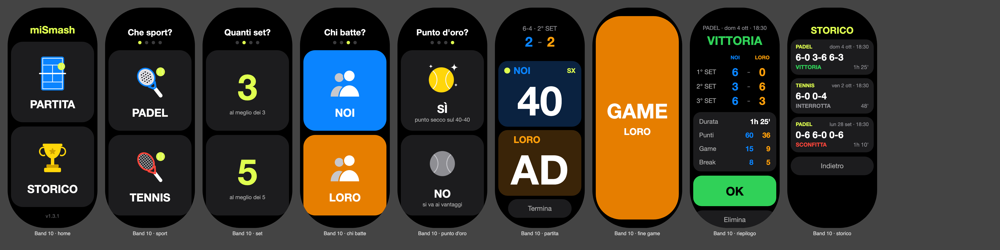
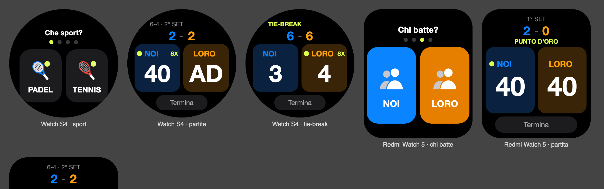

# miSmash · segnapunti padel e tennis per Xiaomi Smart Band e orologi Xiaomi

**Italiano** · [English](README.en.md) · [Español](README.es.md)

App Vela JS (quick app) per contare i punti a padel o a tennis dal polso.

**[⬇ Scarica l'ultima versione](../../releases/latest)** · **[Come installarla](INSTALLAZIONE.md)** · **[☕ Offrimi un caffè](https://www.paypal.com/qrcodes/p2pqrc/QNC3L2PQG7LHG)**





Le immagini sono anteprime generate dal codice dell'app: sul dispositivo vero font e dettagli possono cambiare leggermente.

## Come si usa

1. **Home**: tocca **PARTITA** per iniziare o **STORICO** per le partite giocate.
2. Quattro scelte, una per schermata: **PADEL o TENNIS**, al meglio dei **3 o 5 set**, **chi batte** per primo (NOI / LORO), **punto d'oro** sì o no (nel tennis "punto decisivo"). Dopo l'ultima scelta parte la partita.
   Per tornare alla scelta precedente usa il gesto indietro del dispositivo.
3. **Partita**: tocca il pannello della squadra che ha fatto il punto. **Tieni premuto** un pannello per annullare l'ultimo punto di quella squadra.
   - In alto ci sono i set già chiusi, i game del set in corso e, quando serve, TIE-BREAK o PUNTO D'ORO.
   - Il **pallino giallo** indica chi batte e **DX / SX** da che lato. La battuta cambia da sola a ogni game; nel tie-break segue la regola 1-2-2. Sul punto d'oro il lato non compare, perché lo sceglie chi risponde.
   - A ogni punto il numero si ingrandisce e il pannello si illumina; quando annulli, il numero oscilla.
   - A ogni game, set o fine partita compare per un attimo una schermata colorata. Toccala per chiuderla subito.
4. **Termina** chiude la partita, anche prima della fine (ad esempio quando scade l'ora del campo). Viene salvata nello storico e si apre il **riepilogo**: set, durata, punti, game e break vinti da ciascuna squadra. **OK** riporta alla home.
5. Lo **storico** mostra le ultime 30 partite. Toccane una per vedere il riepilogo; da lì puoi anche eliminarla (con doppio tocco di conferma).

In fondo alla home c'è il numero di versione installata.

Regole: al meglio dei 3 o dei 5 set, set a 6 con tie-break a 7 sul 6-6, vantaggi o punto d'oro. Padel e tennis si contano allo stesso modo.

La partita si salva a ogni punto: se esci dall'app o il bracciale la chiude, riapri e riprendi da dove eri.
Durante la partita lo schermo resta acceso; si spegne di nuovo appena esci dall'app.

**Lingue**: italiano, inglese e spagnolo. L'app usa la lingua del dispositivo (che segue quella del telefono); con qualsiasi altra lingua è in inglese.
Se la vuoi sempre in italiano, installa il pacchetto che finisce con `-it.rpk`.

## Dispositivi

L'app si adatta alla forma dello schermo:

| Forma | Modelli |
|---|---|
| Bracciale (capsula) | Xiaomi Smart Band 9, Smart Band 10 |
| Rettangolare | Xiaomi Smart Band 8 Pro, Smart Band 9 Pro, REDMI Watch 5 |
| Rotondo | Xiaomi Watch S1 Pro, H1, S3, S4, S4 Sport, S5 |

Provata sullo Smart Band 10. Sugli altri modelli il layout è adattato alla forma dello schermo ma non ancora provato su un dispositivo reale: se qualcosa risulta tagliato o fuori posto, segnalalo.
Non funziona su orologi Wear OS (es. Xiaomi Watch 2) né su orologi di altre marche.

## Scaricare e installare

Nella pagina **[Releases](../../releases/latest)** ci sono due file, scegline uno:

- `com.padelscore.band.debug.<versione>.rpk`: lingua automatica (quella del dispositivo);
- `com.padelscore.band.debug.<versione>-it.rpk`: sempre in italiano, qualunque sia la lingua del dispositivo.

Il nome del file resta quello del primo identificativo dell'app (`com.padelscore.band`): cambiarlo farebbe installare miSmash come un'app nuova accanto alla vecchia, che dal bracciale non si può togliere.

Il cavo di ricarica non trasporta dati: l'installazione avviene via Bluetooth con [AstroBox](https://astrobox.online), uno strumento non ufficiale.
Tutti i passaggi, compreso cosa fare se AstroBox non trova il dispositivo dall'account Xiaomi, sono in **[INSTALLAZIONE.md](INSTALLAZIONE.md)**.

## Offrimi un caffè ☕

L'app è gratuita. Se ti è utile e vuoi ringraziare, puoi offrirmi un caffè con PayPal: **[paga con PayPal](https://www.paypal.com/qrcodes/p2pqrc/QNC3L2PQG7LHG)** oppure inquadra il QR.


## Compilare

```bash
npm install
npm test          # test della logica del punteggio
npm run build     # → dist/com.padelscore.band.debug.<versione>.rpk     (lingua automatica)
npm run build:it  # → dist/com.padelscore.band.debug.<versione>-it.rpk  (sempre in italiano)
npm run icon      # rigenera icona dell'app e immagini delle schede
```

Per l'installazione con AstroBox usa sempre il pacchetto **debug** (`npm run build`), non `npm run release`.
Se in `npm run build` compare "missing feature", aggiungi in `features` del manifest quello che indica.
A ogni nuova versione aumenta `versionCode` e `versionName` in `src/manifest.json`: con lo stesso `versionCode` il bracciale tiene la versione vecchia. `versionName` è quella che compare in fondo alla home.

### Pubblicare una nuova versione

1. Aumenta `versionCode` e `versionName` in `src/manifest.json` (e `version` in `package.json`).
2. `npm test`, poi `npm run build` e `npm run build:it`.
3. Su GitHub crea una **Release** con tag `v<versione>` (es. `v1.3.1`), scrivi le novità e allega i due file `.rpk` di `dist/`.
4. Aggiungi la versione in fondo ai README (italiano, inglese, spagnolo), nella sezione [Versioni](#versioni).

## Struttura

```
src/
├── manifest.json          pacchetto, permessi (storage, vibrazione, luminosità, info schermo e app), designWidth 212
├── app.ux
├── common/
│   ├── score.js           logica pura del punteggio (game, set, tie-break, battuta, statistiche, storico)
│   ├── format.js          testi: date, durate, punteggi dei set
│   ├── i18n.js            traduzioni (italiano, inglese, spagnolo) e scelta della lingua
│   ├── build.js           lingua fissa per i pacchetti dedicati (vuota = automatica)
│   ├── icon.png           icona (generata da tools/gen-icon.mjs)
│   └── *.png              immagini delle schede: campo, coppa, racchette, giocatori, palline (idem)
└── pages/index/index.ux   unica pagina: home, scelte, partita, conferma, storico, riepilogo
tools/
├── test-logic.mjs         test della logica (npm test)
├── build-lang.mjs         pacchetto con lingua fissa (npm run build:it)
└── gen-icon.mjs           genera icona e immagini (npm run icon)
```

Gli stili base sono per il bracciale; in fondo a `index.ux` ci sono le varianti `@media (shape: rect)` e `@media (shape: circle)`.
L'altezza dello schermo arriva da `device.getInfo`, perché in px di progetto la larghezza è sempre 212.

## Note per chi modifica l'app

Cose viste sul Band 10 vero, che l'anteprima nel browser non mostra:

- **Angoli dello schermo** molto arrotondati: conta un raggio di circa 90 px (su 212 di larghezza). Per questo ci sono 40 px di margine in alto e 24 in basso, e i pulsanti vicino ai bordi sono stretti e centrati.
- **Sfondi colorati**: su una schermata intera lo sfondo restava nero, sia da classe dinamica sia da stile in linea. Funziona un riquadro interno con la classe scritta nel template e un'altezza fissa (vedi `flash-card`).
- **Animazioni** sotto il mezzo secondo non si vedono: tienile intorno a 0,5-1 s e ben marcate.
- `@system.app` va dichiarato nei `features` del manifest, anche se la documentazione dice di no: senza, la build si ferma.
- **Traduzioni** in `src/common/i18n.js`: ogni lingua deve avere le stesse chiavi (lo controlla `npm test`). Tieni i testi corti; per i pannelli stretti degli orologi ci sono `usShort` e `themShort`.

## Versioni

- **1.3.1**: nuovo nome, miSmash; scelta tra 3 e 5 set; italiano, inglese e spagnolo, più un pacchetto sempre in italiano; le scritte di fine partita (VITTORIA, SCONFITTA) ora stanno nello schermo.
- **1.2.0**: avvio a schermate con immagini (home, sport, chi batte, punto d'oro); tolta la freccia per annullare (resta la pressione lunga).
- **1.1.x**: tennis, Termina, storico e riepilogo con statistiche, schermate GAME / SET, lato di battuta, animazioni, adattamento a orologi rotondi e rettangolari, margini per gli angoli del bracciale, versione visibile in home.
- **1.0.0**: prima versione, segnapunti padel per lo Smart Band 10.

## Licenza

[MIT](LICENSE). Progetto personale e non ufficiale, senza legami con Xiaomi o con AstroBox.
